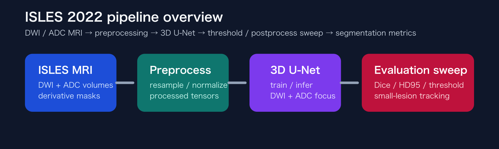
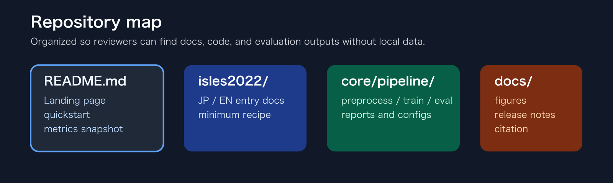
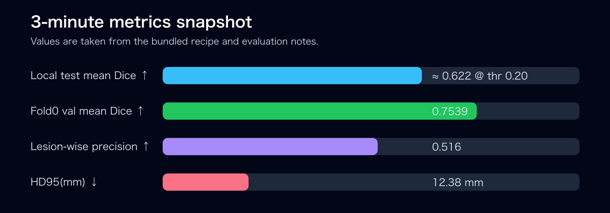

# isles2022-3d-reproducible-pipeline

**Language:** English | [Japanese](README_ja.md)

Reproducible 3D ischemic stroke lesion segmentation pipeline for ISLES 2022, with audit-ready documentation, threshold / postprocess sweeps, and size-stratified evaluation.

> Research / portfolio only. **Not a medical device.** Medical data are not bundled.

**Quick links**
- English entry: [isles2022/README_en.md](isles2022/README_en.md)
- Japanese entry: [isles2022/README.md](isles2022/README.md)
- Detailed documentation: [isles2022/README_en.md](isles2022/README_en.md)
- Reproducibility checklist: [docs/reproducibility_checklist.md](docs/reproducibility_checklist.md)
- Suggested review order: [EN snapshot guide](docs/releases/v0.4.0-isles.md) | [JA snapshot guide](docs/releases/v0.4.0-isles_ja.md)
- GitHub About settings: [EN](docs/github_about.md) | [JA](docs/github_about_ja.md)
- Citation: [CITATION.cff](CITATION.cff)
- Public polish checklist: [docs/audit/polish-isles2022-3d.md](docs/audit/polish-isles2022-3d.md)
- Release note source: [EN](docs/releases/v0.4.0-isles.md) | [JA](docs/releases/v0.4.0-isles_ja.md)
- Roadmap: [ROADMAP.md](ROADMAP.md)

## What this repository provides

- A reproducible preprocess-train-evaluate workflow for ISLES 2022 lesion segmentation
- A 3D U-Net baseline with explicit threshold and connected-component sweeps
- Size-aware reporting for small-lesion performance
- Portfolio-ready documentation for external review
- A no-data smoke test that checks the public bundle without medical data

## Who this is for

- Hiring managers reviewing medical AI segmentation work
- ML engineers looking for an auditable MRI segmentation baseline
- Researchers looking for a reproducible ISLES-style project structure

## Visual overview

<p align="center"></p>

<p align="center"></p>

<p align="center"></p>

### Representative results

| Metric | Value | Why it matters |
|---|---:|---|
| Local test mean Dice | ≈ 0.622 @ threshold 0.20 | Practical performance snapshot for the bundled recipe |
| Fold0 validation mean Dice | 0.7539 | Demonstrates stronger in-distribution validation behavior |
| Lesion-wise precision | 0.516 | Shows the FP-control tradeoff |
| HD95 | 12.38 mm | Boundary quality indicator |

> Notes: values are configuration-dependent and come from the bundled recipe / evaluation notes. Protected medical data is intentionally not included. Research implementation only; **not a medical device**.

## Quickstart

### 1. Verify the repository without medical data

```bash
python scripts/smoke_test.py --use_dummy_data
```

### 2. Inspect the public bundle manifest

```bash
cd core/pipeline
python tools/make_manifest.py
```

### 3. Run full preprocessing / training / evaluation with your own data

- Full guide in English: [isles2022/README_en.md](isles2022/README_en.md)
- Full guide in Japanese: [isles2022/README.md](isles2022/README.md)

## What is included vs excluded

Included:
- source code
- configs
- audit and evaluation documentation
- static summary figures and release-note sources

Not included:
- `Datasets/`
- `runs/`
- `results/`
- `logs/`

## Current portfolio snapshot

Active development continues in this repository. The current portfolio snapshot is:

✅ `v0.4.0-isles`

## How to cite

See [CITATION.cff](CITATION.cff).

## Commit message convention

To keep ongoing changes reviewable, future commits follow Conventional Commits (`type: summary`):

- `fix: leakage check in group split`
- `feat: add calibration evaluation`
- `refactor: manifest validation logic`
- `docs: evaluation protocol clarification`
