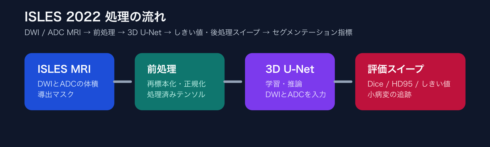
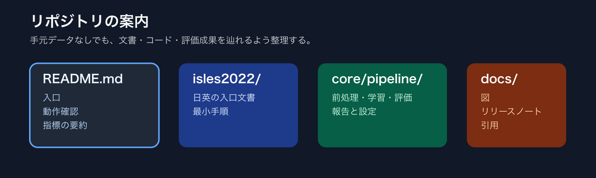
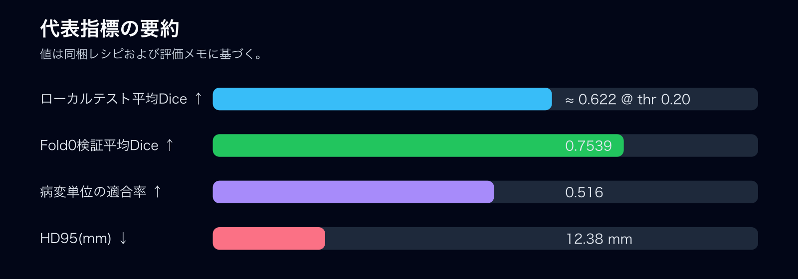

# isles2022-3d-reproducible-pipeline

**言語:** 日本語 | [英語版](README.md)

本リポジトリは、ISLES 2022 向けの再現可能な 3D 脳梗塞病変セグメンテーションパイプラインを公開する。監査しやすい文書、しきい値・後処理のスイープ、サイズ別評価を含む。

> 研究およびポートフォリオ提示を目的とする。**医療機器ではありません。** 医療データ本体は公開物に含めない。

**関連リンク**

- 英語版入口: [isles2022/README_en.md](isles2022/README_en.md)
- 日本語版詳細: [isles2022/README.md](isles2022/README.md)
- 再現性点検表: [docs/reproducibility_checklist_ja.md](docs/reproducibility_checklist_ja.md)
- スナップショット案内: [docs/releases/v0.4.0-isles_ja.md](docs/releases/v0.4.0-isles_ja.md)
- GitHub About: [docs/github_about_ja.md](docs/github_about_ja.md)
- 引用: [CITATION.cff](CITATION.cff)
- ロードマップ: [ROADMAP.md](ROADMAP.md)

## 本リポジトリで確認できること

- ISLES 2022 病変セグメンテーションの前処理、学習、評価の流れ
- 3D U-Net ベースラインと、しきい値・連結成分のスイープ
- 小病変を意識したサイズ別レポート
- 実データなしでの公開物の動作確認

## 処理構成

<p align="center"></p>

<p align="center"></p>

<p align="center"></p>

### 代表指標

| 指標 | 値 | 意味 |
|---|---:|---|
| ローカルテストの平均 Dice | ≈ 0.622 @ threshold 0.20 | 公開レシピの実用的な性能目安 |
| Fold0 検証の平均 Dice | 0.7539 | 同分布の検証データにおける性能 |
| 病変単位の適合率 | 0.516 | 偽陽性制御とのトレードオフ |
| HD95 | 12.38 mm | 境界品質の指標 |

> 数値は同梱レシピと評価メモに基づく。医療データ本体は公開物に含めない。研究実装であり、**医療機器ではありません**。

## 医療データを用いず動作を確認する手順

```bash
python scripts/smoke_test.py --use_dummy_data
```

マニフェスト確認:

```bash
cd core/pipeline
python tools/make_manifest.py
```

実データによる前処理・学習・評価は [isles2022/README.md](isles2022/README.md) を参照する。

## 公開範囲

含むもの: ソース、設定、監査・評価文書、静的図表、リリースノート原稿。

含めないもの: `Datasets/`、`runs/`、`results/`、`logs/`。

## スナップショット

ポートフォリオ用固定タグは `v0.4.0-isles` である。

## 引用

[CITATION.cff](CITATION.cff) に従う。

## コミットメッセージ

Conventional Commits（`fix:`、`feat:`、`docs:` 等）に統一する。
